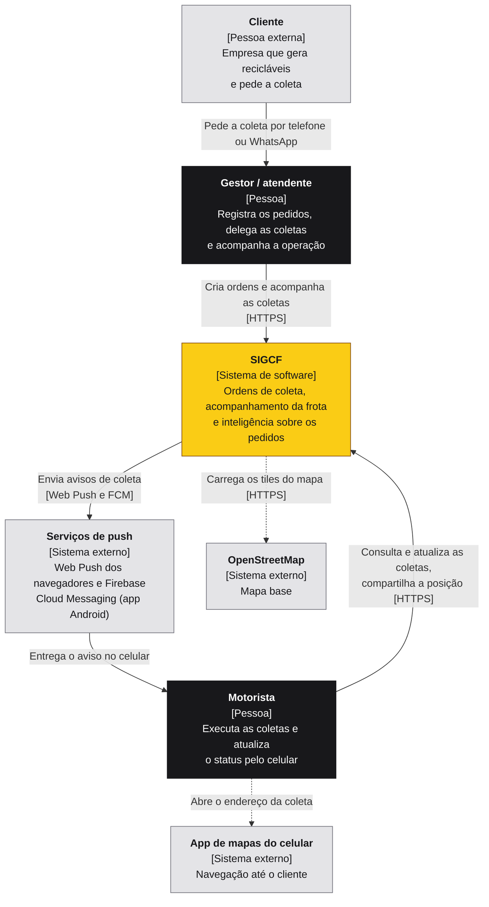
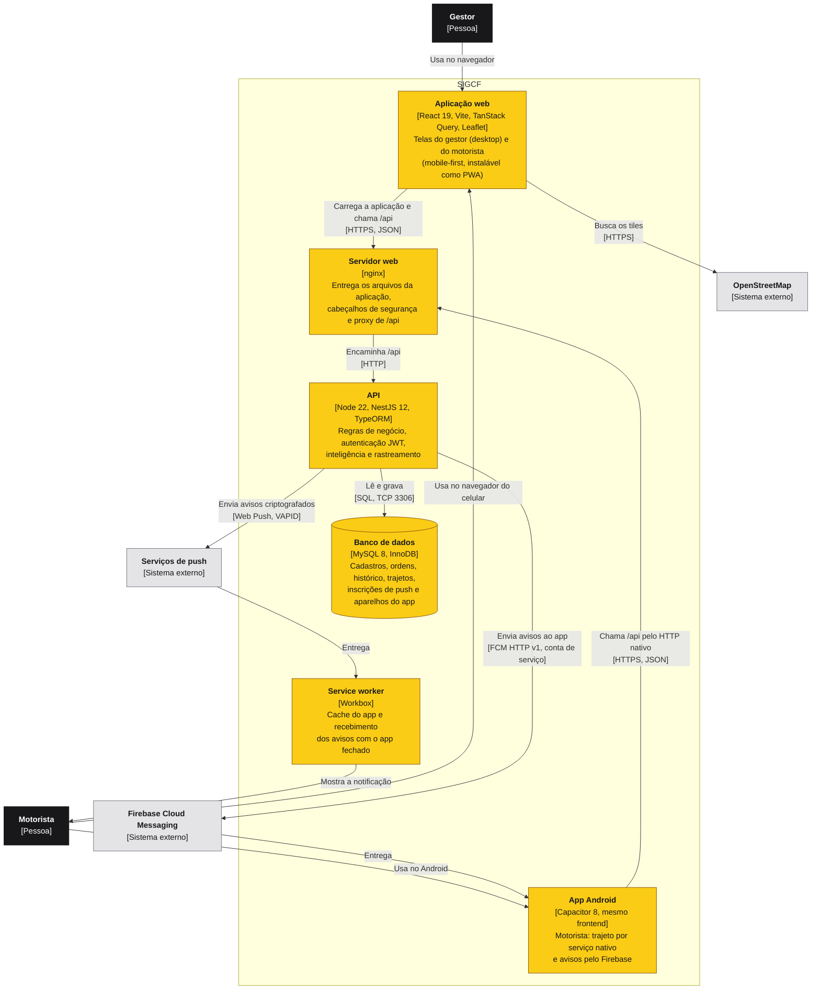
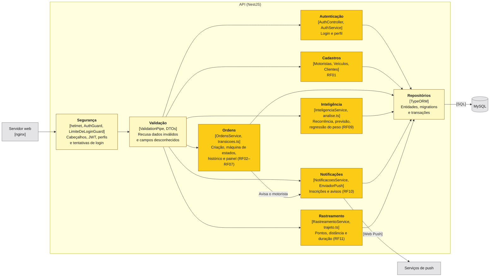
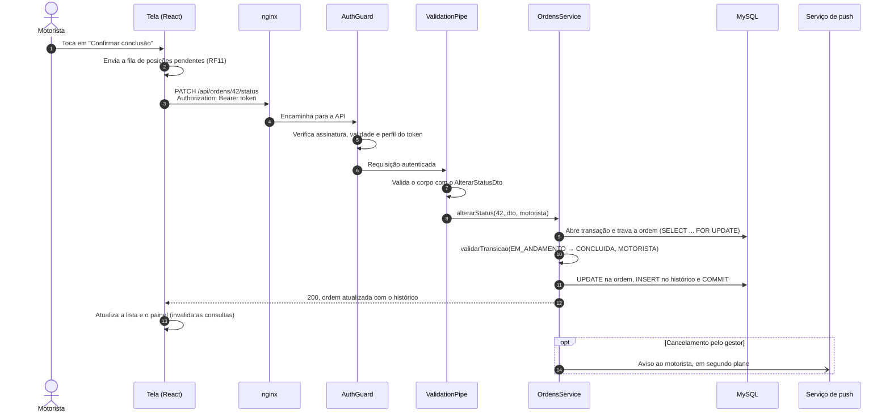

# Arquitetura — SIGCF

Arquitetura descrita com o [modelo C4](https://c4model.com/), em três níveis: contexto, containers e componentes. As decisões que levaram a ela estão nos [ADRs](adr/).

**Legenda dos diagramas:** caixas escuras são pessoas, amarelas são partes do SIGCF e cinza são sistemas externos. Entre colchetes, o tipo do elemento ou a tecnologia.

## Nível 1 — Contexto

Quem usa o sistema e com o que ele se comunica.

## Nível 2 — Containers

As partes executáveis do SIGCF e como conversam.

## Nível 3 — Componentes da API

Cada módulo do NestJS segue as camadas Controller → Service → Repository (RNF02): o controller recebe a requisição já validada, o service aplica a regra de negócio e o repositório do TypeORM acessa o banco.

### Onde fica cada parte

| Pasta | Conteúdo |
|---|---|
| `backend/src/<módulo>/` | Controller, service, entidade, DTOs e testes de cada módulo (`auth`, `clientes`, `motoristas`, `veiculos`, `ordens`, `inteligencia`, `notificacoes`, `rastreamento`) |
| `backend/src/common/` | Validações compartilhadas, datas no fuso de São Paulo e conversão de decimais |
| `backend/src/database/` | Configuração do TypeORM, migrations e seed |
| `backend/test/` | Testes e2e contra um MySQL de verdade |
| `frontend/src/api/` | Cliente HTTP, tipos e consultas (TanStack Query) |
| `frontend/src/auth/` | Sessão, contexto de autenticação e rotas protegidas por perfil |
| `frontend/src/componentes/` | Componentes compartilhados (diálogos, estados, mapa, status) |
| `frontend/src/paginas/` | Telas do gestor e do motorista |
| `frontend/src/util/` | Formatação, localização e notificações |

## Caminho de uma requisição

Do toque do motorista em **Concluir coleta** até o banco de dados:

Uma regra violada vira o código HTTP correspondente: transição inválida → 409, perfil sem permissão → 403, motivo ausente → 400. A ordem de outro motorista responde 404, para não revelar que existe.

## Implantação

Em desenvolvimento e nas demonstrações locais, o Docker Compose sobe os mesmos containers do diagrama de nível 2 (perfil `app`), mais o Adminer para inspecionar o banco e um túnel HTTPS opcional para testar no celular (perfil `tunel`). As instruções de implantação, incluindo a nuvem, estão em [`deploy.md`](deploy.md).
