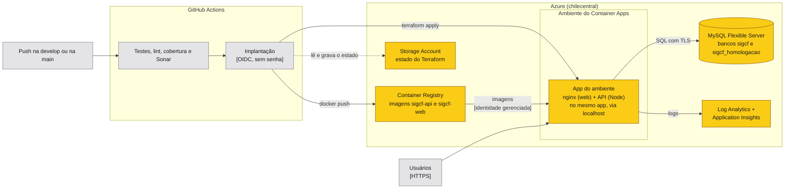

# Implantação — SIGCF

O SIGCF roda no **Azure Container Apps**, com a infraestrutura descrita em **Terraform** e publicada pelo **GitHub Actions**. Nenhuma etapa é manual: o deploy acontece a cada push nas branches de entrega, sem acesso por SSH ou FTP aos servidores.

## Ambientes

| Ambiente | Onde | Alimentado por | Comportamento |
|---|---|---|---|
| Desenvolvimento | Computador do desenvolvedor | Código local | Docker Compose ([README](../README.md#como-executar-localmente)) |
| Homologação | Azure, app `sigcf-homologacao` | Push na `develop` | Desliga sem acessos e acorda no primeiro (custo perto de zero); dados de demonstração |
| Produção | Azure, app `sigcf` | Push na `main`, **após aprovação** | Dorme sem acessos por padrão; nos períodos de avaliação fica **sempre ligada**, com teste de disponibilidade e alerta (ver abaixo) |

A região é a do **Chile (chilecentral)**: a assinatura Azure for Students só permite algumas regiões, e essa é a mais próxima do Brasil. Duas particularidades da assinatura moldaram a infraestrutura:

- **Um único ambiente do Container Apps por região.** Por isso homologação e produção são dois apps no mesmo ambiente, separados por banco de dados, segredos e escala.
- **Modo Express como padrão.** Desde 2026 o Azure cria ambientes no modo Express quando o modo não é informado, e esse modo não aceita dois containers no mesmo app. Como o provedor `azurerm` ainda não tem esse campo, o ambiente é criado com o provedor `azapi`, pedindo o modo `ConsumptionOnly` ([`infra/base/main.tf`](../infra/base/main.tf)).

## Arquitetura de implantação



## Fluxo de entrega

1. O desenvolvedor abre um pull request para a `develop`; o CI roda testes, lint, cobertura e a análise do SonarCloud.
2. Depois do merge, o push na `develop` publica a versão na **homologação**: o job `Implantação` monta as imagens, envia para o registry com a tag do commit, aplica o Terraform do ambiente e confere o health check.
3. Para lançar uma versão, abre-se um pull request da `develop` para a `main`. Depois do merge, o mesmo job publica na **produção**, mas só depois que o responsável aprova a implantação na aba *Actions* do GitHub.

## Primeira configuração (uma vez)

Pré-requisitos: [Azure CLI](https://learn.microsoft.com/cli/azure/install-azure-cli), [Terraform](https://developer.hashicorp.com/terraform/install) 1.9 ou mais novo, [GitHub CLI](https://cli.github.com/) e Node 22. No Windows: `winget install Microsoft.AzureCLI Hashicorp.Terraform GitHub.cli`.

```bash
az login                      # conta da assinatura do Azure
gh auth login                 # conta com acesso de administrador ao repositório

# 1. Registra os provedores e cria a conta de armazenamento do estado do Terraform
bash infra/bootstrap.sh       # anota o nome da conta exibido no final

# 2. Cria a infraestrutura compartilhada (registry, banco, ambiente, monitoramento, identidades)
export ARM_SUBSCRIPTION_ID=$(az account show --query id -o tsv)
export TF_VAR_conta_estado=<conta do passo 1>
export TF_VAR_email_alertas=<e-mail que recebe os alertas>
terraform -chdir=infra/base init \
  -backend-config=resource_group_name=rg-sigcf-estado \
  -backend-config=storage_account_name=$TF_VAR_conta_estado
terraform -chdir=infra/base apply

# 3. Gera as chaves das notificações e grava no GitHub (a privada como segredo)
node infra/configurar-avisos.mjs
```

Por último, crie no repositório os ambientes `homologacao` (só a branch `develop`) e `producao` (só a branch `main`, com o responsável como revisor obrigatório), e cadastre as variáveis do repositório a partir das saídas do passo 2 (`terraform -chdir=infra/base output`):

| Variável do GitHub | Origem |
|---|---|
| `AZURE_CLIENT_ID` | `identidade_implantacao_client_id` |
| `AZURE_TENANT_ID` | `tenant_id` |
| `AZURE_SUBSCRIPTION_ID` | `assinatura_id` |
| `AZURE_REGISTRY` | `registry` |
| `AZURE_REGISTRY_NOME` | `registry_nome` |
| `TF_CONTA_ESTADO` | conta criada no passo 1 |
| `VAPID_CONTATO` | `mailto:` do responsável |
| `VAPID_PUBLIC_KEY` e o segredo `VAPID_PRIVATE_KEY` | gravados pelo passo 3 |

O GitHub Actions entra no Azure por **OIDC**: a identidade `id-sigcf-implantacao` confia apenas em jobs dos ambientes `homologacao` e `producao` deste repositório. Nenhuma senha do Azure fica guardada no GitHub.

## Configuração da aplicação

As variáveis abaixo são definidas pelo Terraform em cada ambiente; os valores sensíveis ficam como *secrets* do Container Apps, nunca no código.

| Variável | Valor na nuvem |
|---|---|
| `NODE_ENV` | `production` (definido na imagem) |
| `DB_HOST`, `DB_PORT`, `DB_USER` | Servidor MySQL gerenciado, porta 3306 |
| `DB_PASSWORD` | Secret gerado pelo Terraform |
| `DB_NAME` | `sigcf` (produção) ou `sigcf_homologacao` |
| `DB_SSL` | `true`: o MySQL do Azure só aceita conexões com TLS |
| `JWT_SECRET` | Secret aleatório de 64 caracteres, um por ambiente |
| `VAPID_*` | Chaves das notificações push |
| `API_UPSTREAM` | `http://localhost:3000` (nginx → API no mesmo app) |

As migrations rodam automaticamente quando a API sobe.

## Tarefas de operação

### Criar o primeiro gestor da produção

Em produção não há dados de demonstração. O primeiro gestor é criado dentro do container, e os demais cadastros passam a ser feitos pela aplicação:

```bash
az containerapp exec --name sigcf --resource-group rg-sigcf --container api --command sh
# dentro do container (a senha é digitada por quem executa, não fica em arquivo):
GESTOR_NOME="Nome do gestor" GESTOR_EMAIL="gestor@empresa.com.br" GESTOR_SENHA="..." node dist/database/criar-gestor.js
```

### Carregar os dados de demonstração na homologação

```bash
az containerapp exec --name sigcf-homologacao --resource-group rg-sigcf --container api --command sh
SEED_SENHA="..." node dist/database/seed.js
```

O seed só roda em banco vazio, e a opção `--recriar` é bloqueada em produção.

### Voltar para a versão anterior (rollback)

Cada implantação usa a tag do commit. Para voltar:

- **Pelo GitHub:** abra, na aba *Actions*, a execução do commit que estava funcionando e use *Re-run jobs* no job `Implantação`. O Terraform aplica de novo as imagens daquele commit.
- **Pela linha de comando:** `terraform -chdir=infra/app apply -var ambiente=producao -var versao=<sha do commit>`, depois do `init` com a chave `app-producao.tfstate`.

O banco não volta junto: migrations são escritas para serem compatíveis com a versão anterior, ou revertidas com `npm run migration:revert`.

### Deixar a produção sempre ligada (períodos de avaliação)

Para economizar crédito, a produção dorme quando ninguém usa, como a homologação: o link funciona, mas o primeiro acesso depois de um tempo parado leva de 20 a 30 segundos. Antes da entrega, da prova de autoria e do Demo Day, deixe-a sempre ligada:

1. No GitHub, em *Settings* → *Secrets and variables* → *Actions* → *Variables*, mude `PRODUCAO_SEMPRE_LIGADA` para `true` (ou `gh variable set PRODUCAO_SEMPRE_LIGADA -b true`).
2. Reimplante a produção: na aba *Actions*, abra a última execução da `main` e use *Re-run jobs* no job `Implantação`, aprovando quando pedido.

Com a variável em `true`, a produção mantém uma réplica ativa e ganha o teste de disponibilidade com o alerta por e-mail. Para voltar ao modo econômico, mude para `false` e reimplante.

### Acompanhar os custos

Um orçamento de US$ 40 por mês envia e-mail ao atingir 50% do valor e quando a previsão do mês passa de 100%. O saldo dos créditos de estudante fica em [microsoftazuresponsorships.com/balance](https://www.microsoftazuresponsorships.com/balance). A homologação desliga sozinha; o Log Analytics tem teto de 0,5 GB de logs por dia.

### Desligar tudo

```bash
terraform -chdir=infra/app destroy -var ambiente=homologacao -var versao=qualquer   # após o init do ambiente
terraform -chdir=infra/app destroy -var ambiente=producao -var versao=qualquer
terraform -chdir=infra/base destroy
```
