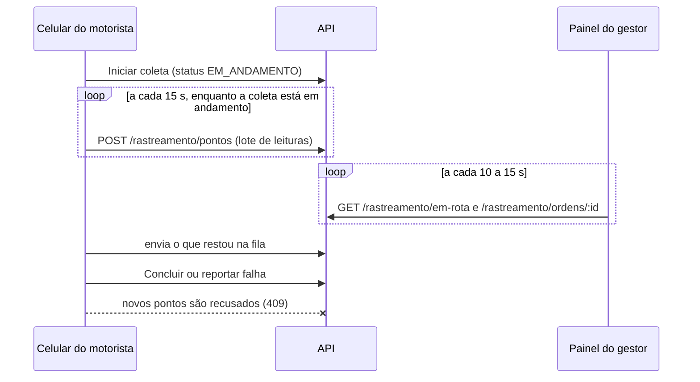

# Trajeto da Coleta (RF11) — Funcionamento e Privacidade

Quando o motorista inicia uma coleta, o gestor passa a ver onde ele está, sem precisar perguntar no grupo do WhatsApp. Quando a coleta termina, o trajeto percorrido, a distância e o tempo da corrida ficam salvos na ordem.

Implementação: [`backend/src/rastreamento/`](../backend/src/rastreamento) (cálculos em [`trajeto.ts`](../backend/src/rastreamento/trajeto.ts)), [`frontend/src/paginas/motorista/useRastreamento.ts`](../frontend/src/paginas/motorista/useRastreamento.ts) e, no app Android, o serviço em [`frontend/android/.../rastreamento`](../frontend/android/app/src/main/java/io/github/guifreiberger/sigcf/rastreamento).

## Fluxo

## No celular do motorista

O motorista pode usar o SIGCF de dois jeitos. No **app Android**, o trajeto continua sendo gravado com a tela apagada ou com ele em outros apps, como o Waze e o WhatsApp ([ADR 0009](adr/0009-app-android-com-capacitor.md)). No **navegador** (inclusive no iPhone), o trajeto só é gravado com o SIGCF aberto na tela.

- **App Android:** ao iniciar a coleta, liga um serviço do próprio app que mantém o GPS ativo e mostra a notificação fixa "SIGCF: coleta em andamento". Na primeira vez, o celular pede as permissões de localização ("durante o uso do app" basta) e de notificação. O serviço guarda cada leitura num arquivo do app e a envia ao servidor por conta própria, sem passar pela tela, que o Android congela com a tela apagada e o celular fora da tomada ([ADR 0010](adr/0010-servico-nativo-de-rastreamento.md)). Cada envio tem tempo-limite (15 s para conectar e 20 s para responder), para uma conexão que caiu, como na troca do Wi-Fi para o 4G, não travar a fila. O serviço continua mesmo se o motorista fechar o app, e desliga ao concluir, ao reportar falha ou quando o servidor informa que a coleta foi cancelada. A tela consulta o serviço a cada 5 segundos para mostrar o aviso e as posições que aguardam envio.

- **Quando começa e termina:** o rastreamento liga sozinho enquanto o motorista tem alguma coleta **em andamento** e desliga quando ela é concluída, reportada como falha ou cancelada pelo gestor. Não há botão para ligar fora de uma coleta.
- **Leitura:** no navegador, a posição vem da [API de Geolocalização](https://developer.mozilla.org/docs/Web/API/Geolocation/watchPosition), com alta precisão; no app, da localização combinada do Google Play Services. Nos dois, é guardada no máximo **uma leitura a cada 10 segundos**, o suficiente para desenhar o caminho sem gastar bateria e dados à toa.
- **Recuperação do GPS (navegador):** num teste de campo em um Android, o acompanhamento contínuo (`watchPosition`) parou de entregar leituras sem avisar, depois que a tela apagou ou o app saiu da frente. Enquanto isso, o pedido avulso de posição (`getCurrentPosition`), usado nas mudanças de status, seguia funcionando. Por isso, se nenhuma leitura chega em 20 segundos, o app refaz o acompanhamento e pede uma posição avulsa, repetindo a cada 10 segundos até as leituras voltarem. O mesmo acontece assim que o motorista volta para o app.
- **Envio:** as leituras ficam numa fila salva no aparelho (no app, num arquivo do serviço) e são enviadas em **lotes a cada 15 segundos**. Sem sinal, a fila cresce (até cerca de 5 horas de leituras) e é enviada quando a conexão volta. Antes de concluir ou reportar falha, o app envia o que estiver na fila. O que não sair a tempo ainda é aceito depois, porque o servidor usa o horário da leitura, e não o da chegada (ver abaixo); no app, o resto é enviado quando o motorista abrir o app de novo.
- **Tela ligada (navegador):** durante a coleta, o navegador usa a [API Screen Wake Lock](https://developer.mozilla.org/docs/Web/API/Screen_Wake_Lock_API) para a tela não apagar. Se o motorista sair do app, a trava cai e é pedida de novo quando ele volta.
- **Transparência:** enquanto compartilha a posição, a tela mostra o aviso "Compartilhando sua localização com o gestor". Se nenhuma posição chega em 30 segundos, o aviso muda para "Procurando o sinal do GPS…", para o motorista não achar que está sendo acompanhado quando não está. Se o GPS estiver bloqueado, a tela orienta a liberar, e a coleta segue funcionando normalmente, apenas sem trajeto.

## No servidor

- `POST /rastreamento/pontos` só aceita leituras do **próprio motorista**, feitas durante uma coleta dele.
- Cada leitura guarda o **horário do celular** (`registrado_em`), não o do envio, e vai para a coleta que estava em andamento **nesse horário**, mesmo que chegue depois de a coleta terminar. Nesse caso, a distância gravada na ordem é recalculada. Uma tolerância de 1 minuto cobre a diferença entre o relógio do celular e o do servidor.
- Leituras de fora de qualquer coleta do motorista são descartadas. Se nenhuma leitura do lote serve e ele não tem coleta em andamento, a resposta é **409**, e o celular descarta a fila.
- Antes, o servidor gravava cada lote na coleta em andamento na hora da chegada. Num teste de campo em 06/11/2026, o envio travou quando o celular trocou o Wi-Fi pelo 4G, e as leituras de uma coleta só chegaram durante a coleta seguinte, que ficou com o trajeto e a distância da anterior. Uma migration devolveu os pontos gravados assim à coleta em que foram lidos e recalculou as distâncias.
- Só o **gestor** consulta os trajetos (`GET /rastreamento/em-rota` e `GET /rastreamento/ordens/:id`).

## Cálculos

| Medida | Regra |
|---|---|
| Pontos confiáveis | Leituras com precisão de até **100 m**. Piores que isso costumam vir da antena de celular ou do Wi-Fi, não do GPS, e são descartadas do mapa e da distância |
| Distância percorrida | Soma dos trechos entre pontos consecutivos pela [fórmula de haversine](https://en.wikipedia.org/wiki/Haversine_formula) (distância sobre a superfície da Terra, raio de 6.371 km). Um trecho só conta quando o deslocamento supera **15 m** e a precisão da própria leitura; isso elimina a oscilação do GPS com o caminhão parado no cliente |
| Início da corrida | Momento em que o motorista iniciou a coleta, pelo histórico de status |
| Fim da corrida | Momento em que a coleta saiu de "em andamento" (concluída, falha ou cancelada) |
| Duração | Fim − início; enquanto a coleta está em andamento, agora − início |
| Última posição | Ponto confiável mais recente |

Enquanto a coleta está em andamento, a duração e a distância são calculadas a partir do histórico e dos pontos. Quando ela termina, as duas ficam gravadas na ordem, para o dashboard e o relatório; leituras que chegam depois atualizam a distância.

## Privacidade (LGPD)

A localização do motorista é dado pessoal. O tratamento segue os princípios do art. 6º da LGPD:

- **Finalidade (I):** acompanhar a execução da coleta e comprovar o atendimento ao cliente. Os pontos não são usados para outra análise.
- **Necessidade (III):** a coleta da posição se limita ao período da corrida. Leituras feitas fora das coletas do motorista são recusadas ou descartadas pelo servidor, mesmo que o aparelho as envie.
- **Transparência (VI):** o motorista vê na tela quando está compartilhando a posição, e o aviso geral da tela explica que a localização só é compartilhada durante a coleta.
- **Segurança (VII):** o acesso aos trajetos é restrito ao perfil gestor e passa pela mesma autenticação JWT do restante da API.

A RNF05 da proposta foi revista para incluir esse tratamento (ver [`tcc/atualizacoes-proposta.tex`](tcc/atualizacoes-proposta.tex)). Uma política de retenção dos pontos (por exemplo, apagar trajetos com mais de 12 meses, alinhada à janela da tela de Inteligência) deve ser definida com a empresa antes do uso em produção.

## Limitações

- **Navegador:** nenhum navegador permite que um site leia o GPS em segundo plano. No navegador, se o motorista bloquear o celular ou trocar de app, o trajeto fica com uma lacuna até ele voltar, e o mapa liga os pontos em linha reta. No Android isso é resolvido pelo app; no iPhone continua valendo, porque publicar para iPhone exige um Mac e a conta paga de desenvolvedor da Apple.
- **Economia de bateria:** o serviço em primeiro plano não é congelado como a tela do app, mas alguns fabricantes encerram serviços por conta própria. O Android recria o serviço, que continua com a fila salva; se ainda assim o trajeto do app apresentar lacunas, o SIGCF precisa sair da otimização de bateria do celular.
- **Atualização do mapa:** o painel consulta a posição a cada 10 a 15 segundos (polling), em vez de receber atualizações em tempo real por WebSocket. Para o volume de uma frota pequena, o atraso é aceitável e a solução é mais simples de operar.
- **Mapa base:** os mapas usam os tiles públicos do OpenStreetMap, com atribuição. Para uso intenso em produção, a [política de uso](https://operations.osmfoundation.org/policies/tiles/) recomenda um provedor de tiles próprio ou contratado.
